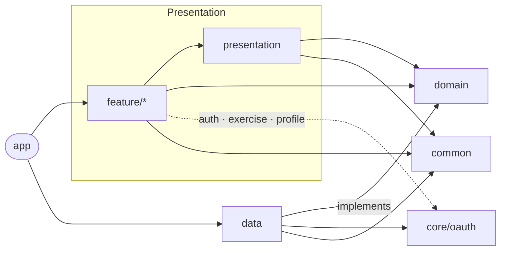

<div align="center">


# 운다방 (Undabang)

운동을 기록하고, 점수를 쌓고, 가까운 운동 메이트를 찾는 안드로이드 앱

[](https://github.com/projects200/android/actions/workflows/android-dev-ci.yml)
[](https://github.com/projects200/android/actions/workflows/android-master-ci-cd.yml)


</div>

---

## 소개

운다방은 혼자 하는 운동을 기록으로 남기고, 그 기록을 근거로 주변 사람과 연결해 주는 앱입니다.
운동을 기록하면 운동 점수가 쌓이고, 지도 위의 다른 사용자는 이 점수와 선호 운동으로 탐색됩니다.

Clean Architecture 기반의 멀티 모듈 구조이며, 운동 기록과 타이머는 Room 캐시를 둔 오프라인 우선 설계입니다.

## 주요 기능

| 탭 | 기능 |
|---|---|
| 운동 기록 | 캘린더 기반 기록 조회, 사진과 장소를 포함한 기록 작성, 운동 점수 획득과 정책 안내, 기록 공유 이미지 편집 |
| 타이머 | 단순 타이머와 스텝 기반 커스텀 인터벌 타이머, 타이머 목록 관리 |
| 매칭 | 카카오맵 위에서 주변 사용자 탐색, 운동 점수와 선호 운동 필터, 운동 장소 등록과 검색, 상대 프로필 조회 |
| 피드 | 피드 목록과 상세, 글 작성 |
| 채팅 | 채팅방 목록, WebSocket 기반 실시간 메시지 송수신 |
| 마이페이지 | 프로필 수정, 선호 운동 설정, 알림 설정, 차단 사용자 관리 |

추가로 Cognito 기반 OAuth 로그인, 약관과 권한 동의 플로우, FCM 푸시 알림(WorkManager로 토큰 동기화 예약)을 지원합니다.

## 아키텍처



화살표는 의존 방향입니다. 단방향이며 역방향 의존은 없습니다.
`domain`은 외부 의존이 하나도 없는 순수 Kotlin 모듈입니다.
`feature`와 `presentation`은 Retrofit과 저장소를 직접 참조하지 않고 UseCase만 호출합니다.

```
View (Fragment / Composable)
  → ViewModel          상태는 StateFlow<UiState<T>>로 노출
  → UseCase            suspend operator fun invoke()
  → Repository         interface는 domain, 구현은 data
  → RemoteDataSource(ApiService) / LocalDataSource(Room)
```

### 모듈

| 모듈 | 역할 |
|---|---|
| `app` | 애플리케이션 진입점, MainActivity, 하단 네비게이션, DI 통합 |
| `domain` | 모델, UseCase, Repository 인터페이스 (Pure Kotlin) |
| `data` | Repository 구현체, Retrofit ApiService, DTO/Mapper, Room `UndabangDatabase` |
| `presentation` | 공통 UI 컴포넌트, `BindingFragment`, `AppTheme`, `UiState` |
| `common` | 공유 유틸, 상수, DI Qualifier |
| `core:oauth` | Cognito + AppAuth 인증, 토큰 저장 (EncryptedSharedPreferences) |
| `feature:auth` | 로그인, 약관 동의, 권한 요청, 회원가입 |
| `feature:exercise` | 운동 기록 목록·상세·작성, 장소 검색, 공유 이미지 |
| `feature:timer` | 단순 타이머, 커스텀 타이머 |
| `feature:matching` | 지도 매칭, 운동 장소 |
| `feature:feed` | 피드 |
| `feature:chatting` | 채팅 목록, 채팅방 |
| `feature:profile` | 마이페이지, 설정 |

## 기술 스택

| 구분 | 사용 기술 |
|---|---|
| 언어 / 빌드 | Kotlin 1.9.23, Gradle Version Catalog, Convention Plugin (`build-logic`) |
| UI | Jetpack Compose (신규 화면), ViewBinding (기존 화면), Navigation Component + SafeArgs |
| DI | Hilt |
| 비동기 | Coroutines, Flow |
| 네트워크 | Retrofit2, OkHttp, Moshi, OkHttp WebSocket (채팅) |
| 로컬 | Room, SharedPreferences, EncryptedSharedPreferences |
| 백그라운드 | WorkManager |
| 지도 | Kakao Map SDK |
| 이미지 | Glide (XML), Coil (Compose) |
| Firebase | FCM, Crashlytics, App Distribution |
| 테스트 | JUnit4, MockK, Truth, Turbine, JaCoCo |
| 품질 | Ktlint, Android Lint |

## 핵심 규칙

**API 호출은 `apiCallBuilder`를 거칩니다.** 서버 응답의 `code`가 `BaseResult.Error.errorCode`로 전달되고 화면 분기가 이 문자열에 걸려 있습니다.

```kotlin
override suspend fun login(): BaseResult<Unit> =
    apiCallBuilder(
        ioDispatcher = ioDispatcher,
        apiCall = { apiService.postLogin(PostLoginRequest("ANDROID", "APP")) },
        mapper = { Unit },
    )
```

**도메인 결과는 `BaseResult`, 화면 상태는 `UiState`입니다.** `errorCode` 문자열은 화면까지 올라가지 않고 `Failure`로 변환됩니다.

```kotlin
sealed class BaseResult<out T> {
    data class Success<T>(val data: T) : BaseResult<T>()
    data class Error(val errorCode: String?, val message: String?, val cause: Throwable?) : BaseResult<Nothing>()
}
```

**오프라인 캐시는 `data` 모듈 안에서만 다룹니다.** 모든 테이블에 `memberId` 컬럼을 두고 DAO 쿼리에 계정 조건을 겁니다.
행은 `localId`(UUID)로 식별하고 `serverId`는 nullable입니다. 동기화 상태는 행마다 `syncState`(`SYNCED` / `CREATE_PENDING` / `UPDATE_PENDING` / `DELETE_PENDING`)로 들고 갑니다.
화면은 Room을 지속 `Flow`로 구독하지 않고 진입 시 스냅샷을 한 번 읽습니다.

**새 화면은 Compose로 만듭니다.** Composable은 상태를 파라미터로 받고 이벤트를 콜백으로 올리며 ViewModel을 직접 참조하지 않습니다.
기존 XML 화면을 고칠 때는 `BindingFragment`를 그대로 씁니다.

## 시작하기

### 요구 사항

- Android Studio (AGP 8.9.1 지원 버전)
- JDK 17
- Android SDK 36, NDK 28.0.10027231

### 설정

1. 저장소를 클론합니다.

   ```bash
   git clone https://github.com/projects200/android.git
   cd android
   ```

2. 루트에 `local.properties`를 만들고 키를 채웁니다.

   ```properties
   sdk.dir=/path/to/Android/sdk

   KAKAO_NATIVE_APP_KEY=...
   KAKAO_REST_API_KEY=...

   # debug 빌드
   COGNITO_USER_POOL_ID_DEV=...
   COGNITO_APP_CLIENT_ID_DEV=...
   COGNITO_REGION_DEV=...

   # release 빌드
   COGNITO_USER_POOL_ID=...
   COGNITO_APP_CLIENT_ID=...
   COGNITO_REGION=...
   ```

3. Firebase 콘솔에서 받은 `google-services.json`을 `app/`에 둡니다.

4. 빌드합니다.

   ```bash
   ./gradlew assembleDebug
   ```

API 서버는 빌드 타입에 따라 갈립니다. debug는 `https://api.undabang.site/dev/`, release는 `https://api.undabang.site/`를 바라봅니다.

## 명령어

```bash
./gradlew ktlintFormat          # 코드 포맷
./gradlew ktlintCheck           # 포맷 검사
./gradlew lint                  # Android Lint
./gradlew testDebugUnitTest     # 단위 테스트 전체
./gradlew :feature:timer:testDebugUnitTest   # 모듈 단위 테스트
./gradlew jacocoLogicReport     # UseCase·ViewModel 커버리지 리포트
./gradlew assembleDebug         # 디버그 APK
./gradlew assembleRelease       # 릴리스 APK
```

## CI/CD

| 워크플로우 | 트리거 | 동작 |
|---|---|---|
| Android CI (dev) | `dev` push, PR | Lint, Ktlint, 단위 테스트, Firebase App Distribution 배포 |
| Android CI/CD (master) | `master` push, PR | Lint, Ktlint, 릴리스 단위 테스트, AAB 빌드, Google Play 내부 테스트 업로드 |

## 기여 규칙

- 작업 브랜치는 `dev`에서 땁니다. 운영 브랜치는 `master`입니다.
- 브랜치 이름은 `{타입}/{설명}-{이슈번호}` 형식입니다. 타입은 `feat` `fix` `refactor` `chore` `docs`입니다.
  예: `fix/fcm-token-sync-565`
- 커밋 메시지는 `{타입}: {한국어 한 줄} #이슈번호` 형식입니다.
- PR 제목은 `{접두} {한국어 제목} #{이슈번호}` 형식입니다. 이슈를 닫으려면 본문에 `Closes #번호`를 씁니다.
- 이슈와 PR 템플릿은 `.github/`에 있습니다.
- 커밋 전에 `./gradlew ktlintFormat`을 한 번 돌립니다.

코드베이스 규약 전문은 [AGENTS.md](AGENTS.md)에 있습니다.

## 라이선스

[Apache License 2.0](LICENSE)
