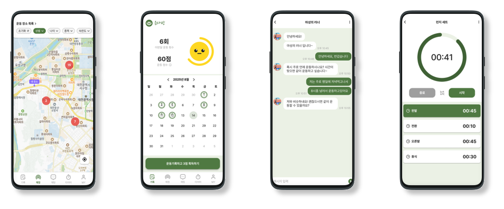
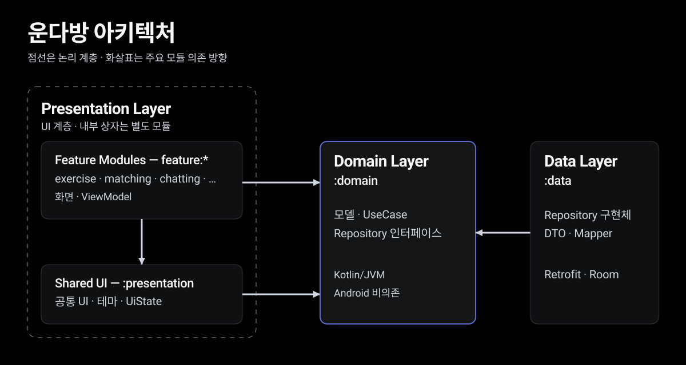

<div align="center">


# 운다방 (Undabang)

운동을 기록하고, 점수를 쌓고, 가까운 운동 메이트를 찾는 안드로이드 앱


<br>


</div>

## 목차

- [프로젝트 소개](#프로젝트-소개)
- [주요 화면](#주요-화면)
- [주요 기능](#주요-기능)
- [구현 포인트](#구현-포인트)
- [아키텍처](#아키텍처)
- [기술 스택](#기술-스택)
- [검증과 배포](#검증과-배포)
- [실행 방법](#실행-방법)

## 프로젝트 소개

운다방은 개인의 운동 기록과 운동 메이트 탐색을 연결하는 앱입니다. 캘린더에 운동을 기록하고, 운동 점수와 선호 운동을 기준으로 주변 사용자를 탐색합니다. 단순 타이머와 커스텀 인터벌 타이머, 피드, 실시간 채팅을 함께 제공합니다.

이 저장소는 운다방의 **Android 클라이언트**입니다. Kotlin 멀티 모듈 구조에서 Compose와 기존 XML 화면을 함께 운영하며, 다음 구현을 중심으로 소개합니다.

- **로컬 변경 보존**: 타이머를 기기에 먼저 저장하고, 서버 목록을 반영할 때 미전송 변경을 보호합니다.
- **백그라운드 작업 제어**: FCM 토큰 전송을 네트워크 조건에 맞춰 예약하고, 실패 유형과 시도 횟수에 따라 재시도를 결정합니다.
- **화면 검증의 정확성**: UI 테스트에서 단순한 탭 선택이나 빈 목록을 조회 성공으로 오인하지 않도록 판정 조건을 구분합니다.

## 주요 화면

<table>
  <tr>
    <th width="25%">지도 매칭</th>
    <th width="25%">운동 기록</th>
    <th width="25%">채팅</th>
    <th width="25%">커스텀 타이머</th>
  </tr>
  <tr>
    <td colspan="4"></td>
  </tr>
</table>

## 주요 기능

1. **운동 기록과 타이머**
   - 캘린더에서 운동 기록을 조회하고, 사진과 장소를 포함한 기록을 작성합니다.
   - 운동 점수와 정책을 확인하고, 기록을 공유 이미지로 편집합니다.
   - 단순 타이머 또는 단계별 시간과 이름을 구성한 커스텀 타이머를 사용합니다.
2. **주변 운동 메이트 탐색과 대화**
   - 카카오맵에서 주변 사용자를 운동 점수·선호 운동으로 탐색하고 프로필을 확인합니다.
   - 운동 장소를 검색·등록하고, 채팅방에서 WebSocket 기반 메시지를 주고받습니다.
3. **피드와 프로필**
   - 피드를 작성하고 목록·상세를 조회합니다.
   - 프로필, 선호 운동, 알림 설정과 차단 사용자를 관리합니다.

로그인은 Cognito 기반 OAuth를 사용하며, 약관·권한 동의와 FCM 푸시 알림을 지원합니다.

## 구현 포인트

### 1. 서버 목록을 다시 받아도 로컬 타이머 변경을 보존하기

**문제** — 기기에서 타이머를 수정한 뒤 서버의 이전 값을 그대로 덮어쓰면 아직 전송하지 않은 변경이 사라질 수 있습니다. 새로 만든 타이머는 서버 ID가 없으므로 서버 ID만으로는 식별할 수도 없습니다.

**구현** — 생성·수정·삭제는 Room에 먼저 반영하고, 로컬 식별자와 서버 식별자를 분리합니다. 서버 목록을 반영할 때는 변경 대기 중인 항목을 제외하고 동기화가 끝난 항목만 갱신합니다. 계정별 조회 조건은 LocalDataSource에서 적용합니다.

- 서버에 없는 타이머를 수정하면 생성 대기를 유지하고, 삭제하면 로컬에서 바로 지웁니다.
- 서버에 있는 타이머를 삭제하면 삭제 대기 상태로 남겨 서버에 전달할 정보를 보존합니다.
- 서버 조회가 네트워크 오류로 실패하면 저장된 타이머를 읽습니다.

**트레이드오프** — 커스텀 타이머 목록 API에는 실행 단계가 없어 항목별 상세 조회가 추가됩니다. 단계까지 로컬에 보관하기 위해 추가 요청 비용을 감수하는 구조입니다. 여기서 설명하는 범위는 로컬 저장과 서버 조회 결과 반영이며, 서버 전송 완료를 보장한다는 의미는 아닙니다.

**관련 테스트** — 미전송 수정 보존, 생성·삭제 상태 전이, 계정별 데이터 분리를 메모리 DB로 검사하는 테스트가 있습니다.

[저장 로직](data/src/main/java/com/project200/data/datasource/TimerLocalDataSource.kt) · [서버 조회와 로컬 읽기](data/src/main/java/com/project200/data/impl/TimerRepositoryImpl.kt) · [회귀 테스트](data/src/test/java/com/project200/data/datasource/TimerLocalDataSourceTest.kt)

### 2. FCM 토큰 전송의 실행 조건과 재시도 범위 나누기

**문제** — FCM 토큰 갱신 콜백은 백그라운드에서도 호출됩니다. 콜백 시점에 네트워크 연결과 로그인 상태를 전제할 수 없고, 일시적인 전송 실패와 재시도로 복구되지 않는 인증 오류도 구분해야 합니다.

**구현** — 토큰을 기기에 저장한 뒤 WorkManager에 전송을 예약합니다. 네트워크 연결 조건과 지수 백오프를 적용하고, 같은 이름의 작업은 새 요청으로 교체합니다. 재시도 판단은 Android 의존성이 없는 정책 객체로 분리했습니다.

- 작업당 총 시도 횟수는 최대 10회로 제한합니다.
- 리프레시 토큰이 무효한 `invalid_grant`는 재시도하지 않습니다.
- 로그인 전이거나 전송할 토큰이 없는 경우는 전송을 건너뜁니다.

**트레이드오프** — 콜백 즉시 전송하는 대신 작업 실행 조건이 충족될 때까지 서버 반영이 늦어질 수 있습니다. 새 토큰으로 작업을 교체하면 백오프와 시도 횟수도 새 작업 기준으로 시작합니다.

**관련 테스트** — 첫 실패, 재시도 상한 직전·도달·초과, 인증 오류에 따른 재시도 여부를 검사합니다.

[토큰 수신](app/src/main/java/com/project200/undabang/fcm/FcmService.kt) · [전송 Worker](app/src/main/java/com/project200/undabang/fcm/FcmTokenSyncWorker.kt) · [재시도 정책](app/src/main/java/com/project200/undabang/fcm/FcmTokenSyncPolicy.kt) · [경계값 테스트](app/src/test/java/com/project200/undabang/fcm/FcmTokenSyncPolicyTest.kt)

### 3. UI 테스트가 빈 화면을 성공으로 오인하지 않게 하기

**문제** — 탭 제목이 보인다는 사실만으로 콘텐츠 로딩 성공을 판단할 수 없습니다. 빈 목록도 초기 상태, 조회 실패, 실제로 데이터가 없는 성공 응답에서 모두 나타날 수 있습니다.

**구현** — Maestro의 피드 검증은 탭 선택 상태에 더해 실제 콘텐츠 또는 성공한 빈 응답의 선택자를 확인합니다. ViewModel에서는 조회 완료 여부를 따로 관리하고, 최신 요청의 성공 응답일 때만 완료 상태를 부여합니다. Compose 화면은 이 상태에 따라 빈 결과 선택자를 노출합니다.

**검증 범위** — 새 조회·실패 시 이전 완료 상태를 유지하지 않는지, 늦게 도착한 이전 빈 응답을 최신 조회의 완료로 인정하지 않는지를 회귀 테스트로 다룹니다. 이 판정은 UI 테스트용 완료 상태에 관한 것으로, 모든 목록 갱신 경쟁을 해결했다는 의미는 아닙니다.

**트레이드오프** — UI 테스트가 화면의 의미 있는 상태를 확인할 수 있도록 접근성 선택자를 관리해야 합니다. 로그인 필요 플로우는 로그인된 기기를 준비해야 하며 OAuth 로그인 자체는 자동화하지 않습니다.

[화면 상태](feature/feed/src/main/java/com/project200/undabang/feature/feed/list/FeedListViewModel.kt) · [Compose 선택자](feature/feed/src/main/java/com/project200/undabang/feature/feed/list/FeedListScreen.kt) · [회귀 테스트](feature/feed/src/test/java/com/project200/undabang/feature/feed/FeedListViewModelTest.kt) · [Maestro 플로우](.maestro/flows/smoke-tabs.yaml)

## 아키텍처



`Presentation Layer`는 기능 모듈과 공통 UI 모듈 `:presentation`을 묶은 **논리적 UI 계층**입니다. 기능은 `exercise`, `matching`, `chatting`, `…`로 축약했으며, 기능 모듈이 `:presentation` 안에 포함된다는 뜻은 아닙니다.

화살표는 **참조하는 모듈 → 참조되는 모듈** 방향의 Gradle 의존성입니다. 화면 요청의 실행 순서를 뜻하지 않습니다. 그림에서 생략한 `app`·`common`·`core:oauth`·`build-logic`의 역할과 전체 직접 참조 관계는 아래 표에 정리했습니다.

`domain`은 모델·UseCase·Repository 인터페이스를 정의하는 Kotlin/JVM 모듈입니다. Repository 구현과 API·Room 접근은 `data`에 두며, `feature:*`는 `data`를 직접 참조하지 않습니다. `common`과 `core:oauth`는 Android 라이브러리이지만 `domain`에서는 참조하지 않습니다.

- **화면과 도메인 경계**: 기능별 `feature` 모듈과 공통 UI인 `presentation`을 분리합니다. Compose 화면과 ViewBinding 화면이 공존하며 Navigation Component로 화면을 연결합니다.
- **구현과 계약의 분리**: `domain`의 규칙과 인터페이스는 Android 저장소 구현 없이 JVM 테스트 대상으로 다룰 수 있습니다. 의존성 연결에는 Hilt를 사용합니다.
- **공통 빌드 설정**: `build-logic`의 Convention Plugin에서 Android·Kotlin·Hilt·Compose·Ktlint·JaCoCo 설정을 재사용합니다.

<details>
<summary>모듈별 역할</summary>

| 모듈 | 역할 |
|---|---|
| `app` | 앱 진입점, 하단 내비게이션, FCM, DI 통합 |
| `domain` | 모델, UseCase, Repository 인터페이스 |
| `data` | Repository 구현, Retrofit, DTO·Mapper, Room |
| `presentation` | 공통 UI, 테마, 공통 `UiState`(로딩·성공·오류), 오류 표현 |
| `common` | 공유 유틸, 상수, DI Qualifier |
| `core:oauth` | Cognito·AppAuth 인증과 토큰 저장 |
| `feature:auth` | 로그인, 약관·권한 동의, 회원가입 |
| `feature:exercise` | 운동 기록, 장소 검색, 공유 이미지 |
| `feature:timer` | 단순·커스텀 타이머 |
| `feature:matching` | 지도 매칭, 운동 장소 |
| `feature:feed` | 피드 목록·상세·작성 |
| `feature:chatting` | 채팅 목록·채팅방 |
| `feature:profile` | 마이페이지, 설정 |
| `build-logic` | 공통 빌드 설정 |

### 직접 참조 관계

외부 라이브러리가 아닌 프로젝트 모듈 간 의존성만 정리했습니다. `build-logic`은 런타임 의존성과 별개인 포함 빌드입니다.

| 참조하는 모듈 | 직접 참조하는 프로젝트 모듈 |
|---|---|
| `app` | 모든 `feature:*`, `presentation`, `data`, `domain`, `common`, `core:oauth` |
| 모든 `feature:*` | `presentation`, `domain`, `common` |
| `feature:auth`, `feature:exercise`, `feature:profile` | 위 공통 의존성에 더해 `core:oauth` |
| `presentation` | `domain`, `common` |
| `data` | `domain`, `common`, `core:oauth` |
| `domain`, `common`, `core:oauth` | 다른 프로젝트 모듈을 직접 참조하지 않음 |

근거: [app](app/build.gradle.kts), [feature 모듈](feature), [presentation](presentation/build.gradle.kts), [data](data/build.gradle.kts), [domain](domain/build.gradle.kts), [common](common/build.gradle.kts), [core:oauth](core/oauth/build.gradle.kts)의 빌드 설정.

[모듈 선언](settings.gradle.kts) · [Convention Plugin](build-logic/convention/src/main/java/com/project200/convention)

### 도식 표현 참고

모듈과 의존성은 이 저장소의 Gradle 설정을 기준으로 했으며, 다음 자료에서는 배치와 표기 원칙을 참고했습니다.

- [Now in Android 모듈화 예제](https://github.com/android/nowinandroid/blob/main/docs/ModularizationLearningJourney.md): 기능별 그룹과 계층적 배치.
- [Android 공식 모듈화 패턴](https://developer.android.com/topic/modularization/patterns#dependency-inversion): 추상화와 구현이 분리된 의존성 표현.
- [C4 도식 표기 지침](https://c4model.com/diagrams/notation): 도식의 범위·범례·짧은 역할 설명.

</details>

## 기술 스택

| 영역 | 기술 | 이 프로젝트에서의 용도 |
|---|---|---|
| 언어·빌드 | Kotlin, Gradle Kotlin DSL, Version Catalog, Convention Plugin | 의존성 버전 관리와 모듈 공통 빌드 설정 재사용 |
| UI | Jetpack Compose, ViewBinding, Navigation Component | Compose·XML 화면 구성과 화면 전환 |
| 상태·비동기·DI | ViewModel, Coroutines, Flow, Hilt | 화면 상태 관리, 비동기 처리·상태 전달, 의존성 주입 |
| 네트워크·인증 | Retrofit, OkHttp·WebSocket, Moshi, Cognito·AppAuth | REST API·실시간 채팅 연결, JSON 매핑, OAuth 로그인 |
| 로컬·백그라운드 | Room, SharedPreferences, EncryptedSharedPreferences, WorkManager | 타이머 로컬 저장, 사용자 설정·인증 상태 보관, FCM 토큰 전송 작업 예약 |
| 지도·이미지 | Kakao Map SDK, Glide, Coil | 주변 운동 메이트·운동 장소 지도 표시와 이미지 로딩 |
| Firebase | FCM, Crashlytics, Analytics, Performance, Remote Config, App Distribution | 푸시 알림, 크래시·사용 지표·성능 수집 설정, 원격 설정, 테스트 앱 배포 |
| 검증 | JUnit4, MockK, Truth, Turbine, Robolectric, JaCoCo, Maestro, Ktlint, Android Lint | 로직·저장소·UI 테스트 구성, 커버리지 수집, 정적 검사 |

세부 버전은 [Version Catalog](gradle/libs.versions.toml)에서 관리합니다.

## 검증과 배포

구현 사례별 소스와 테스트는 위 링크에서 확인할 수 있습니다.

- **로직·저장소**: UseCase·ViewModel 단위 테스트, Robolectric 기반 Room 테스트를 두고 있습니다. JaCoCo 집계 대상은 UseCase·ViewModel입니다.
- **사용자 흐름**: Maestro 플로우로 로그인 화면, 하단 탭과 콘텐츠, 운동 기록 작성 화면 진입을 검사하도록 구성했습니다. 기기 준비와 실행 조건은 [Maestro 가이드](.maestro/README.md)에 있습니다.
- **CI/CD 구성**: `dev` push·PR은 debug 검증과 Firebase App Distribution 배포, `master` push·PR은 release 검증을 수행하도록 설정되어 있습니다. Google Play 내부 테스트 배포는 `master` push에서만 실행합니다.

[dev 워크플로우](.github/workflows/android-dev-ci.yml) · [master 워크플로우](.github/workflows/android-master-ci-cd.yml)

### 현재 지원 범위

- [운동 기록 Repository](data/src/main/java/com/project200/data/impl/ExerciseRecordRepositoryImpl.kt)와 타이머 목록은 항상 Room 스냅샷을 먼저 읽습니다. 최초 진입·새 날짜/월 선택은 저장된 결과를 즉시 표시하고, ViewModel 수명의 별도 서버 갱신은 Room만 바꿉니다. 갱신 완료·재연결은 표시 중인 목록·상세·캘린더나 수정 중인 폼을 교체하지 않습니다. **새로고침**은 서버를 기다린 뒤 결과를 표시하며 복귀와 자신의 쓰기 후에는 Room만 다시 읽고 선택 날짜·월·스크롤을 보존합니다.
- 오프라인에서는 성공한 빈 목록도 읽고, 미조회 쿼리는 네트워크 오류로 구분합니다. 온라인 미적중은 첫 서버 결과를 Room에서 읽으며 중복 갱신을 시작하지 않습니다. 명시적 갱신 실패는 저장된 화면과 오류를 함께 전달합니다. 운동 생성·수정·삭제·이미지 작업은 여전히 온라인 전용이며 Room 목록·상세·횟수를 함께 맞춥니다. 네트워크 대기 중에도 로컬 읽기와 타이머 편집·삭제가 가능하며, 계정과 수정 세대가 달라진 조회 응답은 반영하지 않습니다.
- Room 6은 계정·기록별 운동 전송 저널과 안정적인 사진 로컬 ID·서버 ID·파일 경로·요청 ID를 보존합니다. 저널·목록·상세·사진의 저장은 한 트랜잭션이며 최신 편집은 전송 중 원문과 키를 덮어쓰지 않습니다. 서버 version과 확정 날짜의 미확인 값은 null로 남깁니다. 2→3→4→5→6은 기존 운동·사진 JSON·타이머·전송 중 영수증·빈 조회 이력을 보존하고, 전송 계약이 불명확한 과거 대기 행이나 손상된 사진 JSON은 자동 전송하지 않는 복구 필요 상태로 남깁니다. 미지원 업그레이드·다운그레이드는 원본을 재생성하지 않고 열기에 실패합니다. 운동 오프라인 CRUD·사진 파일 작업·전송 Worker는 아직 연결하지 않았습니다.
- 타이머는 계정·종류별 빈 스냅샷 여부와 revision을 보존하며 마지막 로컬 행 삭제도 빈 조회를 유지합니다. 명시적 로그아웃의 전체 테이블 정리는 운동 저널과 사진 메타데이터도 지웁니다. 운동 서버 쓰기 후 캐시 반영 실패는 성공과 `CACHE_ERROR` 경고로 전달하고 캐시 무효 표시를 저장합니다. 다음 조회는 재다운로드 가능한 캐시와 조회 마커만 정리하며 저널·사진 대기 작업·앱 소유 파일이 연결된 투영은 보존합니다. 서버 쓰기를 재시도하지 않으며 무효 표시 저장도 실패하면 오래된 캐시가 남을 수 있습니다.
- 앱 시작 시 IO 코루틴이 `ClockProvider.now().minusMonths(6)`보다 이른 운동 횟수·목록·상세와 빈 응답 조회 마커를 한 트랜잭션으로 정리합니다. 기준일은 포함해 보관하며, 목록 없는 상세는 운동 시작 날짜로 판정합니다. 서버 ID가 있는 `SYNCED` 기록만 삭제하고, 같은 회원의 로컬/서버 ID로 연결된 대기·로컬 전용·보관 기간 안의 기록과 타이머는 보존합니다. 정리는 앱 시작을 기다리게 하지 않으며 실패해도 앱 초기화를 중단하지 않습니다.
- `dev` CI는 `jacocoLogicCoverageVerification`으로 domain 테스트와 ViewModel·UseCase 집계 LINE 80% 이상을 검사하고 `jacocoLogicReport`를 생성합니다. `android-local-first-evidence` artifact는 KSP가 실제 생성한 Room 스키마 JSON과 테스트·커버리지 결과를 보관합니다. Maestro는 별도 실제 DEV 계정·기기 검증이 필요합니다.
- `dev` 워크플로우에는 배포를 push로 제한하는 조건이 없어 PR에도 배포 단계가 있습니다. 배포 구성은 공개 출시 여부나 실제 배포 성공을 뜻하지 않습니다.

## 실행 방법

JDK 17, Android SDK Platform 36, NDK 28.0.10027231을 사용합니다. Gradle은 저장소의 Wrapper(8.11.1)를 사용하며, Android Studio는 AGP 8.9.1을 지원하는 버전이 필요합니다. 실행 기기는 Android 8.0(API 26) 이상이며 APK에 포함하는 ABI는 `armeabi-v7a`, `arm64-v8a`입니다.

외부 서비스 설정이 필요하므로 클론만으로는 앱 실행 준비가 끝나지 않습니다. 개발용 Cognito·Kakao 값과 Firebase 설정 파일을 준비합니다.

<details>
<summary>개발 환경 설정과 첫 빌드</summary>

1. `dev` 브랜치를 클론하고 Android Studio에서 루트 폴더를 엽니다.

   ```bash
   git clone --branch dev https://github.com/projects200/android.git
   cd android
   ```

2. Gradle JDK와 터미널의 `JAVA_HOME`을 JDK 17로 맞춥니다. 루트 `local.properties`의 기존 `sdk.dir`은 유지하고 아래 값을 추가합니다. `YOUR_...`는 개발 환경용 실제 값으로 바꿉니다.

   ```properties
   sdk.dir=/path/to/Android/sdk
   KAKAO_NATIVE_APP_KEY=YOUR_DEV_NATIVE_APP_KEY
   KAKAO_REST_API_KEY=YOUR_REST_API_KEY
   COGNITO_USER_POOL_ID_DEV=YOUR_DEV_USER_POOL_ID
   COGNITO_APP_CLIENT_ID_DEV=YOUR_DEV_APP_CLIENT_ID
   COGNITO_REGION_DEV=YOUR_DEV_REGION
   ```

   Kakao 키는 파일에 없으면 같은 이름의 환경변수를 읽습니다. Cognito 값은 `local.properties`에서만 읽습니다.

3. 개발용 Firebase 파일을 `app/src/debug/google-services.json`에 둡니다.
4. Gradle Sync 후 `app` 모듈의 `debug` 변형을 실행하거나 APK를 빌드합니다.

   ```bash
   ./gradlew :app:assembleDebug
   ```

   APK: `app/build/outputs/apk/debug/app-debug.apk`

Windows에서는 `./gradlew` 대신 `gradlew.bat`를 사용합니다. 설정 파일과 서명 키는 커밋하지 않습니다.

</details>

<details>
<summary>빌드·테스트 명령</summary>

저장소 루트에서 실행합니다.

```bash
./gradlew ktlintCheck                       # Kotlin 포맷 검사
./gradlew ktlintFormat                      # Kotlin 포맷 수정
./gradlew lintDebug                         # debug Android Lint
./gradlew testDebugUnitTest :domain:test     # Android 모듈 + domain 단위 테스트
./gradlew :feature:timer:testDebugUnitTest   # 타이머 모듈 단위 테스트
./gradlew jacocoLogicReport                 # UseCase·ViewModel 커버리지
./gradlew jacocoLogicCoverageVerification       # 라인 커버리지 80% 미만이면 실패
./gradlew :app:assembleDebug                # 디버그 APK
```

`domain`은 Kotlin/JVM 모듈이므로 `testDebugUnitTest`만으로는 해당 테스트가 실행되지 않습니다. JaCoCo HTML 리포트 경로는 `build/reports/jacoco/jacocoRootReport/html/index.html`입니다.

</details>

<details>
<summary>개발·운영 환경과 릴리스 서명</summary>

| 항목 | `debug` | `release` |
|---|---|---|
| 앱 이름 | 운다방(Debug) | 운다방 |
| API 서버 | `https://api.undabang.site/dev/` | `https://api.undabang.site/` |
| Cognito 설정 | `COGNITO_*_DEV` | `COGNITO_*` |
| Firebase 파일 | `app/src/debug/google-services.json` | `app/src/release/google-services.json` |

릴리스 작업에는 운영용 Firebase 파일과 다음 `local.properties` 항목이 추가로 필요합니다.

```properties
COGNITO_USER_POOL_ID=YOUR_PROD_USER_POOL_ID
COGNITO_APP_CLIENT_ID=YOUR_PROD_APP_CLIENT_ID
COGNITO_REGION=YOUR_PROD_REGION
```

배포용 서명은 `android.injected.signing.store.file`, `android.injected.signing.store.password`, `android.injected.signing.key.alias`, `android.injected.signing.key.password` Gradle 프로젝트 속성(`-P`)으로 전달합니다.

[앱 빌드 설정](app/build.gradle.kts) · [API 환경 선택](data/src/main/java/com/project200/data/di/NetworkModule.kt) · [릴리스 워크플로우](.github/workflows/android-master-ci-cd.yml)

</details>

## 기여와 라이선스

개발 브랜치는 `dev`, 운영 브랜치는 `master`입니다. 상세 규약은 [AGENTS.md](AGENTS.md)를 참고하고, 변경 내용과 실제 검증 범위는 [PR 템플릿](.github/PULL_REQUEST_TEMPLATE.md)에 기록합니다.

[버그 보고](.github/ISSUE_TEMPLATE/bug_report.md) · [기능 제안](.github/ISSUE_TEMPLATE/feature_request.md) · [Apache License 2.0](LICENSE)
