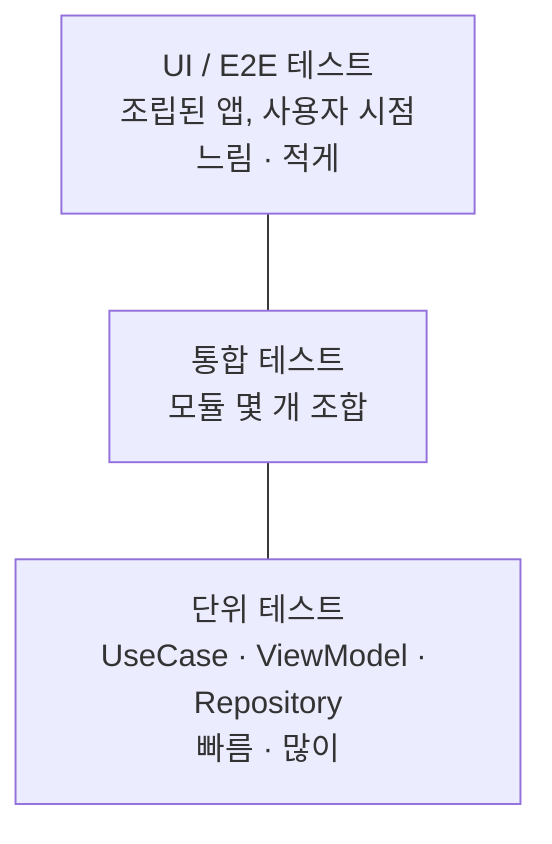
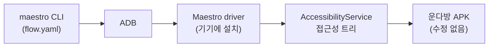

# UI 테스트와 Maestro 자동화

운다방 안드로이드 레포를 기준으로 쓴 학습 문서입니다. UI 테스트가 무엇을 지키는지부터 시작해서, Maestro로 플로우를 쓰고 CI에 붙이는 데까지 다룹니다.

문서에 적힌 Maestro 사실은 2026년 10월 기준 공식 문서(`docs.maestro.dev`)와 GitHub 릴리스에서 확인한 것입니다. 확인하지 못한 것은 그렇다고 적었습니다.

---

## 1. UI 테스트가 무엇을 지키는가

단위 테스트는 함수 하나의 계약을 지킵니다. UseCase가 Repository를 제대로 호출하는지, ViewModel이 에러를 `UiState.Failure`로 바꾸는지 같은 것들입니다. 운다방에는 이 층이 이미 있습니다. `jacocoLogicReport`가 UseCase와 ViewModel 커버리지를 집계합니다.

단위 테스트가 못 잡는 것이 있습니다.

- 화면 전환이 끊기는 경우. `MainActivity`가 `EntryState.Login`일 때 `LoginActivity`로 못 넘어가는 상황은 ViewModel 테스트로 안 잡힙니다
- Navigation 그래프 연결이 어긋난 경우
- 권한 다이얼로그 뒤로 화면이 막히는 경우
- 레이아웃이 깨져 버튼이 화면 밖으로 밀린 경우
- 모듈을 조립했을 때만 터지는 Hilt 주입 실패

UI 테스트는 이런 "조립된 상태의 앱"을 사용자 시점에서 검증합니다. 느리고 비싸기 때문에 많이 쓰지 않습니다. 테스트 피라미드가 말하는 바가 이것입니다. 단위 테스트를 바닥에 두껍게 깔고, UI 테스트는 돈 되는 경로에만 얇게 얹습니다.



### 운다방 현황

UI 테스트는 아직 없습니다. `androidTest` 소스셋에 파일이 11개 있지만 전부 Android Studio가 만들어 준 `ExampleInstrumentedTest` 템플릿입니다. 패키지명만 확인하는 코드입니다.

테스트 의존성은 이미 걸려 있습니다. `AndroidApplicationConventionPlugin`이 `androidx-test-ext-junit`, `androidx-test-espresso-core`, `mockk`, `kotlinx-coroutines-test`를 넣고, Compose 플러그인이 `compose-ui-test-junit4`를, Hilt 플러그인이 `hilt-android-testing`을 넣습니다.

즉 계측 테스트를 쓸 준비는 되어 있고, 쓰지 않고 있습니다.

---

## 2. 안드로이드 UI 테스트의 두 갈래

접근 방식이 두 가지로 갈립니다. 테스트 코드가 앱 프로세스 **안**에서 도느냐 **밖**에서 도느냐입니다. 이 차이가 나머지 모든 성질을 결정합니다.

### 2.1 계측 테스트 (in-process, 화이트박스)

`androidTest` 소스셋에 Kotlin으로 씁니다. 빌드하면 APK가 두 개 나옵니다. 앱 APK와 테스트 APK입니다. 테스트 APK가 앱과 같은 프로세스에 올라가서 앱 내부 객체를 직접 건드립니다.

**Espresso** — XML View 기반 화면용입니다. 운다방의 `activity_login.xml`을 대상으로 쓴다면 이런 모양이 됩니다.

```kotlin
@RunWith(AndroidJUnit4::class)
class LoginActivityTest {
    @get:Rule
    val activityRule = ActivityScenarioRule(LoginActivity::class.java)

    @Test
    fun 로그인_화면에_카카오_구글_버튼이_보인다() {
        onView(withId(R.id.kakao_login_btn)).check(matches(isDisplayed()))
        onView(withId(R.id.google_login_btn)).check(matches(isDisplayed()))
    }
}
```

`onView(matcher).perform(action).check(assertion)` 세 박자가 전부입니다. `withId`, `withText`, `isDisplayed` 같은 매처를 조합합니다.

**Compose UI Test** — Composable용입니다. `createAndroidComposeRule`로 Activity를 띄우거나 `createComposeRule`로 Composable만 띄웁니다.

```kotlin
class TimerListScreenTest {
    @get:Rule
    val composeRule = createComposeRule()

    @Test
    fun 타이머_목록에_심플_타이머_카드가_보인다() {
        composeRule.setContent {
            AppTheme {
                TimerListScreen(
                    customTimers = emptyList(),
                    onBackClick = {},
                    onSimpleTimerClick = {},
                    onCustomTimerClick = {},
                    onAddCustomTimerClick = {},
                )
            }
        }
        composeRule.onNodeWithText("심플 타이머").assertIsDisplayed()
    }
}
```

Compose 쪽은 노드를 `onNodeWithText`, `onNodeWithTag`, `onNodeWithContentDescription`으로 찾습니다. `onNodeWithTag`를 쓰려면 Composable에 `Modifier.testTag("...")`를 붙여 둬야 합니다. 운다방 Compose 화면에는 현재 `testTag`가 없습니다.

**동기화 문제** — 계측 테스트의 가장 큰 통증입니다. 테스트 스레드가 "다음 줄"을 바로 실행하는데 앱은 아직 네트워크 응답을 기다리는 중일 수 있습니다. Espresso는 메인 루퍼가 idle 상태가 될 때까지는 기다려 주지만 백그라운드 작업은 모릅니다. 그래서 `IdlingResource`를 수동으로 등록해야 합니다. Compose는 `composeRule.waitUntil { ... }`로 직접 대기 조건을 적습니다. 이 동기화를 빠뜨리면 테스트가 됐다 안 됐다 하는 flaky 테스트가 됩니다.

### 2.2 블랙박스 E2E (out-of-process, 사용자 시점)

테스트 러너가 앱 밖에서 기기를 조종합니다. 앱 내부를 모르고, 화면에 보이는 것과 접근성 정보만 봅니다.

- **UIAutomator** — 구글 공식. 앱 경계를 넘어 설정 앱이나 시스템 다이얼로그까지 조작할 수 있습니다. Kotlin으로 씁니다
- **Appium** — WebDriver 프로토콜 기반. 안드로이드와 iOS를 하나의 테스트 코드로 다루려는 쪽에서 씁니다. 설정이 무겁습니다
- **Maestro** — YAML로 플로우를 적습니다. 이 문서의 주제입니다

### 2.3 둘의 차이

| 항목 | 계측 테스트 (Espresso / Compose) | 블랙박스 (Maestro) |
|---|---|---|
| 실행 위치 | 앱 프로세스 안 | 앱 밖 |
| 앱 쪽 준비 | 테스트 의존성, 테스트 APK 빌드 필요 | 없음 |
| 작성 언어 | Kotlin | YAML |
| 내부 접근 | 가능 (Hilt 모듈 교체, 객체 주입) | 불가 |
| 동기화 | 수동 (`IdlingResource`, `waitUntil`) | 자동 재시도 내장 |
| 앱 경계 밖 | 제한적 (UIAutomator 병행 필요) | 시스템 다이얼로그 조작 가능 |
| 리팩터링 내성 | 낮음 (ID와 내부 구조에 걸림) | 높음 (보이는 텍스트에 걸림) |
| 실행 속도 | 빠름 | 느림 (앱 설치, 실제 탭 동작) |

하나를 고르는 문제가 아닙니다. Compose 컴포넌트 단위 검증은 Compose UI Test가 맞고, "로그인부터 운동 기록 작성까지"처럼 화면을 가로지르는 시나리오는 Maestro가 맞습니다.

---

## 3. Maestro

### 3.1 정체

mobile-dev-inc가 만든 오픈소스(Apache-2.0) 모바일 UI 자동화 도구입니다. CLI는 무료입니다. 호스팅 실행 환경인 Maestro Cloud는 유료 상품으로 따로 있습니다.

- 최신 안정 버전: CLI **2.11.0** (2026-09-29 릴리스)
- 요구사항: **Java 17 이상**, `JAVA_HOME`이 그 JDK를 가리켜야 합니다

### 3.2 동작 원리

Maestro는 앱 안에 들어가지 않습니다. ADB로 기기에 붙고, 안드로이드 접근성 서비스가 노출하는 접근성 트리를 읽어서 요소를 찾고, 좌표를 계산해 탭을 보냅니다. 스크린 리더가 화면을 읽는 방식과 같습니다.



여기서 따라오는 결론이 중요합니다.

- **앱에 의존성을 추가하지 않습니다.** `build.gradle.kts`를 건드릴 일이 없습니다. Firebase에 올리는 그 debug APK를 그대로 테스트합니다
- **UI 프레임워크를 가리지 않습니다.** 운다방처럼 XML 화면과 Compose 화면이 섞여 있어도 하나의 플로우로 가로지릅니다
- **접근성 정보가 없으면 Maestro도 못 봅니다.** `contentDescription` 없는 아이콘 버튼은 찾을 수단이 줄어듭니다. 접근성을 챙기는 일이 곧 테스트 가능성을 챙기는 일이 됩니다

### 3.3 자동 대기

Maestro는 각 커맨드가 실패하면 일정 시간 동안 자동으로 재시도합니다. `assertVisible`도 "지금 보이나"가 아니라 "곧 보이나"를 묻습니다. 네트워크 응답을 기다리는 화면에 `sleep`을 박을 필요가 줄어듭니다.

다만 만능은 아닙니다. 기본 대기 시간은 7초입니다. 로그인 직후 초기 동기화처럼 이보다 오래 걸리는 구간은 `extendedWaitUntil`로 타임아웃을 명시해야 합니다. `scrollUntilVisible`은 별도로 20초 기본값을 씁니다.

### 3.4 설치

macOS 기준입니다.

```bash
# 방법 1
curl -fsSL "https://get.maestro.mobile.dev" | bash

# 방법 2
brew tap mobile-dev-inc/tap
brew trust --formula mobile-dev-inc/tap/maestro
brew install mobile-dev-inc/tap/maestro

maestro --help
```

프로젝트 JDK가 17이므로 추가로 맞출 것은 없습니다.

---

## 4. 첫 플로우 만들기

### 4.1 디렉터리

관례상 레포 루트에 `.maestro/`를 둡니다. 운다방에 적용한다면 이런 모양이 자연스럽습니다.

```
.maestro/
├── config.yaml
├── subflows/
│   ├── launch-logged-in.yaml
│   └── go-to-tab.yaml
└── flows/
    ├── smoke-tabs.yaml
    ├── timer-create.yaml
    └── exercise-record.yaml
```

`config.yaml`은 워크스페이스 설정입니다. `flows` 글롭 패턴, 태그 필터, 실행 순서, 리포트 출력 디렉터리를 담습니다.

```yaml
# .maestro/config.yaml
flows:
  - "flows/**"
  - "!subflows/**"   # ! 접두는 제외
excludeTags:
  - wip
testOutputDir: build/maestro
```

`flows` 기본값은 `*`라서 루트 YAML만 집어갑니다. 하위 폴더를 쓰려면 `**`를 명시해야 합니다.

### 4.2 플로우 파일 구조

파일 하나가 플로우 하나입니다. `---` 위가 설정, 아래가 커맨드 목록입니다.

```yaml
appId: com.project200.undabang
name: 하단 탭 스모크
tags:
  - smoke
env:
  START_TAB: "기록"
---
- launchApp
- assertVisible: ${START_TAB}
```

`appId`가 필수입니다. 운다방은 `com.project200.undabang`입니다. debug 빌드에 `applicationIdSuffix`가 없어서 debug와 release 패키지명이 같습니다. 앱 이름만 `운다방(Debug)`로 갈립니다.

### 4.3 운다방 스모크 플로우

하단 탭 다섯 개를 돌면서 각 화면이 떴는지만 확인하는 플로우입니다. 탭 제목은 `app/src/main/res/values/strings.xml`에, 화면 제목은 각 feature 모듈 `strings.xml`에 있습니다.

```yaml
# .maestro/flows/smoke-tabs.yaml
appId: com.project200.undabang
name: 하단 탭 스모크
tags:
  - smoke
---
- launchApp:
    clearState: false      # 로그인 세션을 유지합니다

# 기록 탭 (XML 화면입니다. 하단 작성 버튼으로 확인합니다)
- tapOn: "기록"
- assertVisible:
    id: exercise_create_btn

# 매칭 탭
- tapOn: "매칭"
- assertVisible: "운동 장소 목록"

# 피드 탭 (Compose 화면. 상단바 제목이 탭 이름과 같습니다)
- tapOn: "피드"
- assertVisible: "피드"

# 채팅 탭
- tapOn: "채팅"

# MY 탭
- tapOn: "MY"

- takeScreenshot: smoke-tabs-done
```

탭 이름과 화면 제목이 같은 경우를 조심해야 합니다. 피드 탭은 하단 탭 라벨도 `피드`이고 상단바 제목도 `피드`라서 `assertVisible: "피드"`는 탭을 누르지 않아도 통과합니다. 실제로는 그 화면에만 있는 문자열(예: 비어 있을 때 뜨는 `아직 작성된 피드가 없어요`)이나 관계형 셀렉터로 좁혀야 의미가 생깁니다. 아무 때나 통과하는 단언은 테스트가 아닙니다.

### 4.4 실행

```bash
# 에뮬레이터 또는 기기 하나가 붙어 있어야 합니다
adb devices

maestro test .maestro/flows/smoke-tabs.yaml

# 파일을 저장할 때마다 자동 재실행 (플로우 쓰면서 쓰기 좋습니다)
maestro test -c .maestro/flows/smoke-tabs.yaml

# 폴더 전체 + 태그 필터
maestro test --include-tags=smoke .maestro/

# JUnit XML 리포트
maestro test --format junit --output build/maestro/report.xml .maestro/
```

Maestro는 앱이 이미 설치되어 있다고 가정합니다. 설치는 `adb install`로 따로 합니다. `clearState`는 `adb shell pm clear <패키지명>`과 같아서 로그인 세션과 Room 캐시가 함께 날아갑니다. 로그인 상태를 유지해야 하는 플로우에서는 켜지 마십시오.

---

## 5. 셀렉터 고르기

커맨드 대부분이 셀렉터를 받습니다. 문자열 하나만 주면 `text` 셀렉터로 해석합니다.

```yaml
- tapOn: 기록          # { text: "기록" } 과 같습니다
```

여러 조건을 주면 **전부 만족**하는 요소를 찾습니다 (AND).

```yaml
- tapOn:
    id: kakao_login_btn
    enabled: true
    below: 로그인
```

### 5.1 기본 셀렉터

| 셀렉터 | 설명 |
|---|---|
| `text` | 화면에 보이는 텍스트. 안드로이드에서는 `contentDescription`도 매칭합니다 |
| `id` | 안드로이드 리소스 ID |
| `index` | 같은 조건에 여러 개가 걸릴 때 몇 번째인지 (0부터) |
| `point` | 좌표. `"50%, 50%"` 또는 `"100, 250"` |

`text`와 `id`는 **정규식으로 해석됩니다.** `$`나 `[` 같은 문자는 역슬래시로 이스케이프합니다. 동적인 값은 이 성질을 이용합니다.

```yaml
- assertVisible: "좋아요 \\d+"
```

### 5.2 관계형 셀렉터

고유한 식별자가 없는 요소를 주변 요소로 찍습니다.

- `above` `below` `leftOf` `rightOf` — 화면상 위치 기준
- `childOf` `containsChild` — 직계 부모자식 관계
- `containsDescendants` — 깊이 상관없이 후손 여러 개를 포함하는 요소

```yaml
# 리스트에서 특정 타이머 카드의 화살표를 누릅니다
- tapOn:
    rightOf: "인터벌 트레이닝"
```

### 5.3 상태 셀렉터

`enabled` `checked` `focused` `selected`입니다. 특히 `enabled: true`가 유용합니다. API 응답을 기다려 활성화되는 버튼에 걸면, Maestro가 버튼이 눌릴 수 있게 될 때까지 기다린 뒤 탭합니다.

```yaml
- tapOn:
    text: "완료"
    enabled: true
```

### 5.4 운다방에서는 무엇을 쓰나

**XML 화면** — `android:id`가 그대로 `id` 셀렉터가 됩니다.

```yaml
- tapOn:
    id: kakao_login_btn
```

`activity_login.xml`에 `kakao_login_btn`, `google_login_btn`, `logo`가 있고 `activity_main.xml`에 `bottom_navigation`, `nav_host_fragment`가 있습니다. 텍스트가 런타임에 바뀌는 요소는 특히 `id`로 잡아야 합니다. 운동 기록 화면의 하단 버튼은 XML에 `운동 기록하고 점수 얻기`로 적혀 있지만 `ExerciseMainFragment`가 점수에 따라 `운동 기록하고 N점 획득하기` 또는 `운동 기록하기`로 갈아끼웁니다. 텍스트로 잡으면 상태에 따라 깨집니다.

**Compose 화면** — 리소스 ID가 없습니다. 세 가지 선택지가 있습니다.

1. **보이는 텍스트.** `tapOn: "완료"`. 가장 읽기 쉽고, 텍스트가 바뀌면 깨지는 것이 오히려 맞습니다. 사용자가 보는 것이 바뀐 것이니까요
2. **`contentDescription`.** 텍스트 없는 아이콘 버튼용입니다. Composable에 접근성 레이블을 달면 `text` 셀렉터로 잡힙니다
   ```kotlin
   Modifier.semantics { contentDescription = "피드 작성" }
   ```
   공식 Jetpack 문서는 `description` 키로도 씁니다.
   ```yaml
   - tapOn:
       description: "피드 작성"
   ```
3. **`testTag`를 `id`로 노출.** 기본 상태에서는 `testTag`가 Maestro의 `id`로 잡히지 않습니다. 루트에 `testTagsAsResourceId = true`를 걸어야 테스트 태그가 리소스 ID로 올라옵니다.
   ```kotlin
   Modifier.semantics { testTagsAsResourceId = true }
   ```
   이 설정은 하위 모든 `testTag`에 적용됩니다.

운다방 Compose 화면에는 현재 `testTag`도 `testTagsAsResourceId`도 없습니다. 더 큰 문제가 따로 있습니다. **아이콘과 이미지의 `contentDescription`이 전부 `null`입니다.** `ExerciseFormScreen`의 카메라 아이콘, 사진 삭제 버튼, `ExerciseDetailScreen`의 공유와 메뉴 버튼 모두 `contentDescription = null`로 선언되어 있습니다. 접근성 트리에 라벨이 안 올라가므로 Maestro가 이 버튼들을 셀렉터로 집을 수 없습니다. 좌표(`point`)나 관계형 셀렉터로 우회하는 수밖에 없고, 둘 다 레이아웃이 바뀌면 깨집니다.

당분간은 보이는 텍스트 위주로 가고, 아이콘 전용 버튼에서 막힐 때 `contentDescription`을 하나씩 채우는 쪽이 비용이 적습니다. 테스트 전용 코드가 아니라 접근성 개선이라 프로덕션에 남겨도 되는 변경입니다.

**선택 기준 요약** — 사람이 읽는 텍스트가 있으면 텍스트를 씁니다. 아이콘이면 `contentDescription`을 답니다. 리스트처럼 같은 것이 반복되면 관계형 셀렉터로 앵커를 잡습니다. `index`는 마지막 수단입니다. 순서가 바뀌면 조용히 틀린 것을 누릅니다.

---

## 6. 커맨드 지도

전체 목록은 공식 레퍼런스에 있습니다. 자주 쓰는 것만 분류해 둡니다.

**조작** — `tapOn` `doubleTapOn` `longPressOn` `inputText` `eraseText` `pasteText` `setClipboard` `copyTextFrom` `hideKeyboard`

**이동** — `scroll` `scrollUntilVisible` `swipe` `back` `pressKey` `openLink`

**앱 제어** — `launchApp` `killApp` `stopApp` `clearState`

**검증** — `assertVisible` `assertNotVisible` `assertTrue` `assertScreenshot` `assertDarkMode` `assertLightMode`

**기기 상태** — `setPermissions` `setLocation` `setOrientation` `setDarkMode` `setAirplaneMode` `travel` `addMedia`

**대기** — `waitForAnimationToEnd` `extendedWaitUntil`

**흐름 제어** — `runFlow` `runScript` `evalScript` `repeat` `retry`

**기록** — `takeScreenshot` `startRecording` `stopRecording`

**AI (베타)** — `assertWithAI` `assertNoDefectsWithAI` `extractTextWithAI`

### 권한 처리

운다방은 위치, 알림, 저장소 권한을 씁니다. 권한 다이얼로그를 매번 탭으로 넘기는 대신 `launchApp`에서 미리 정합니다. Maestro는 기본적으로 전부 허용합니다.

```yaml
# 권한 거부 경로를 테스트합니다
- launchApp:
    clearState: true
    permissions:
      all: deny
      location: allow
```

중간에 바꾸려면 `setPermissions`를 씁니다. 표준 이름(`location` `notifications` `camera` `storage` 등)에 없는 권한은 전체 권한 ID를 그대로 적습니다.

---

## 7. 흐름 제어와 재사용

### 7.1 서브플로우

반복되는 앞부분을 떼어 냅니다.

```yaml
# .maestro/subflows/launch-logged-in.yaml
appId: com.project200.undabang
---
# clearState를 켜면 로그인 세션까지 날아가 LoginActivity로 떨어집니다 (9.2 참고)
- launchApp:
    clearState: false
    permissions:
      all: allow

# 스플래시에서 EntryState가 Content로 확정될 때까지 기다립니다
- extendedWaitUntil:
    visible: "기록"
    timeout: 20000
```

```yaml
# 호출하는 쪽
- runFlow: ../subflows/launch-logged-in.yaml
```

화면 단위로 서브플로우를 쪼개는 방식이 Page Object Model에 해당합니다. 공식 문서에 레시피가 있습니다.

### 7.2 조건

`when`에 `visible` `notVisible` `platform` `true`(JS 표현식)를 겁니다. 조건을 여러 개 주면 AND입니다.

```yaml
# 업데이트 안내가 뜨면 닫고 진행합니다
- runFlow:
    when:
      visible: "업데이트"
    commands:
      - tapOn: "나중에"
```

### 7.3 optional

없을 수도 있는 요소를 건드릴 때 씁니다. 실패해도 플로우가 멈추지 않습니다.

```yaml
- tapOn:
    text: "확인"
    optional: true
```

조건부 다이얼로그에 `optional: true`를 남발하면 테스트가 아무것도 검증하지 않게 됩니다. 정말로 나타날 수도 아닐 수도 있는 것에만 씁니다.

### 7.4 반복과 재시도

```yaml
- repeat:
    times: 3
    commands:
      - scroll

- repeat:
    while:
      notVisible: "더 이상 기록이 없어요"
    commands:
      - scroll

- retry:
    maxRetries: 2
    commands:
      - tapOn: "완료"
      - assertVisible: "축하해요"
```

`repeat: while`은 종료 조건이 안 오면 안 끝납니다. 횟수 상한을 같이 거는 쪽이 안전합니다.

### 7.5 훅

`onFlowStart`와 `onFlowComplete`로 플로우 앞뒤에 공통 작업을 붙입니다. 실패 시 스크린샷 같은 것을 여기에 둡니다.

### 7.6 운동 기록 작성 플로우 예시

`ExerciseFormScreen`을 대상으로 한 플로우입니다. 진입 화면인 `ExerciseMainFragment`는 XML이고 작성 화면은 Compose라서, 한 플로우가 두 UI 프레임워크를 가로지릅니다. 문자열과 ID는 `feature/exercise/src/main/res/`에서 가져왔습니다.

```yaml
# .maestro/flows/exercise-record.yaml
appId: com.project200.undabang
name: 운동 기록 작성
tags:
  - regression
---
- runFlow: ../subflows/launch-logged-in.yaml

- tapOn: "기록"

# 하단 작성 버튼 (XML, id로 집습니다)
- tapOn:
    id: exercise_create_btn
- assertVisible: "운동 기록하기"

# 제목 입력 (ASCII만 들어갑니다. 9절 참고)
- tapOn:
    below: "제목 *"
- inputText: "Maestro test record"
- hideKeyboard

# 완료 버튼은 상단바에 있습니다 (presentation 모듈의 공통 문자열입니다)
- tapOn:
    text: "완료"
    enabled: true

# 저장 후 목록 화면으로 돌아옵니다
- extendedWaitUntil:
    visible:
      id: exercise_create_btn
    timeout: 15000
- assertVisible: "Maestro test record"
```

---

## 8. JavaScript와 테스트 데이터

Maestro 2.0부터 JS 엔진이 GraalJS입니다. Java 17 이상이 필요한 이유이기도 합니다.

쓰는 방법이 세 가지입니다.

```yaml
# 1. 인라인 표현식
- inputText: ${'user_' + Date.now()}

# 2. evalScript
- evalScript: ${output.startedAt = new Date().getTime()}

# 3. 외부 파일
- runScript:
    file: ../scripts/seed.js
    env:
      API_BASE: "https://api.undabang.site/dev"
```

`output` 객체가 플로우 전역 변수입니다. 스크립트에서 넣은 값을 YAML에서 `${output.xxx}`로 읽습니다.

`http` 객체로 API를 직접 부를 수 있습니다. UI로 10단계를 거쳐야 만들어지는 데이터를 API 한 번으로 만들어 두고, UI는 "그게 제대로 보이는지"만 확인하는 방식이 가능합니다.

```javascript
// .maestro/scripts/seed.js
const res = http.post(`${API_BASE}/exercises`, {
  headers: { 'Content-Type': 'application/json', Authorization: `Bearer ${TOKEN}` },
  body: JSON.stringify({ title: `maestro-${Date.now()}` }),
});
const data = json(res.body);
output.recordTitle = data.data.title;
```

```yaml
- runScript: ../scripts/seed.js
- launchApp
- tapOn: "기록"
- scrollUntilVisible:
    element:
      text: ${output.recordTitle}
```

`faker` 객체로 랜덤 데이터도 만듭니다. 다만 한글은 못 넣습니다. 9절을 보십시오.

Maestro는 네트워크 모킹 기능이 없습니다. 실제 서버를 쓰거나 별도 목 서버를 띄워야 합니다. 운다방 debug 빌드는 `https://api.undabang.site/dev/`를 보므로 dev 서버가 테스트 대상이 됩니다.

---

## 9. 운다방에서 막힐 지점

문서를 읽고 바로 쓰려 하면 걸리는 것들을 미리 적어 둡니다.

### 9.1 한글 입력이 안 됩니다

가장 큰 제약입니다. 안드로이드에서 `inputText`는 **ASCII만** 지원합니다. 한글을 넣을 수 없습니다. 공식 문서가 명시한 한계이고 우회책도 문서화되어 있지 않습니다.

`setClipboard` + `pasteText` 조합이 있지만, Maestro 내부 클립보드를 쓰는 것이라 안드로이드 유니코드 입력 제약을 넘는지는 공식 문서가 확인해 주지 않습니다. 실제 기기에서 직접 확인해야 합니다.

읽는 쪽은 문제없습니다. 한글 텍스트로 요소를 찾고(`tapOn: "운동 장소 목록"`) 검증하는(`assertVisible: "심플 타이머"`) 것은 정상 동작합니다.

실무 결론은 이렇습니다. 입력값이 필요한 테스트는 영문/숫자로 적고, 한글 입력 자체를 검증해야 한다면 API로 데이터를 심은 뒤 표시를 확인하는 쪽으로 돌립니다.

### 9.2 OAuth 로그인

운다방 로그인은 AppAuth(`net.openid.appauth` 0.11.1)가 Cognito 인증 페이지를 띄웁니다. `AuthManager.initiateAuthorization()`이 `authService.getAuthorizationRequestIntent()`를 날리고, AppAuth가 Custom Tab 또는 브라우저를 고릅니다.

여기서 화면이 **운다방 앱 밖**으로 나갑니다. Maestro 플로우는 `appId` 하나를 기준으로 돌기 때문에 멀티앱 시나리오가 제약을 받습니다. 브라우저 권한은 Maestro가 통제하지 못한다고 문서가 명시합니다.

접근 방법이 몇 가지 있습니다.

- 로그인 플로우 자체를 자동화 대상에서 뺍니다. 로그인된 기기 상태를 만들어 두고 `launchApp: { clearState: false }`로 세션을 재사용합니다. 대부분의 시나리오는 로그인 이후 화면이므로 이 방법으로 커버됩니다
- 로그인 플로우만 따로 둡니다. 브라우저 화면의 요소를 셀렉터로 잡는 시도를 하되, 깨지기 쉬우니 스모크 하나로 제한합니다
- 테스트 전용 진입 경로를 앱에 둡니다. 다만 이 선택은 프로덕션 코드에 테스트용 분기를 넣는 것이라 별도 판단이 필요합니다. Maestro에는 자동화 실행 여부를 앱에서 감지하는 기능이 있습니다

### 9.3 카카오맵

`MatchingMapScreen`의 지도는 네이티브 렌더링입니다. 마커와 클러스터는 접근성 트리에 요소로 올라오지 않습니다. 셀렉터로 마커를 찍을 수 없습니다.

지도 영역은 `point` 셀렉터로 좌표를 찍거나, 지도 위에 얹힌 일반 UI(필터 칩, 현재 위치 버튼, 운동 장소 목록 버튼)만 검증 대상으로 삼는 쪽이 현실적입니다. `setLocation`으로 GPS 좌표를 고정하면 지도 시작 위치가 매번 같아져 재현성이 올라갑니다.

### 9.4 Room 캐시

Maestro는 앱 내부 DB를 직접 들여다볼 수 없습니다. 오프라인 캐시 동작은 UI로만 검증합니다.

`setAirplaneMode`가 있어서 오프라인 전환 시나리오는 만들 수 있습니다. 비행기 모드를 켜고 기록을 작성한 뒤 목록에 보이는지, 다시 켜고 동기화되는지를 UI로 확인하는 식입니다. `syncState` 같은 내부 상태는 못 봅니다. 그쪽은 단위 테스트와 Room 인메모리 테스트의 영역입니다.

### 9.5 WebView

접근성 API로는 WebView 내부에 접근하기 어렵습니다. `androidWebViewHierarchy: devtools` 플래그가 우회책으로 제공됩니다.

### 9.6 기타

- Maestro 드라이버 APK 설치가 보안 정책이 강한 기기나 MDM 기기에서는 실패할 수 있습니다. 표준 에뮬레이터를 쓰십시오
- iOS는 시뮬레이터만 지원합니다 (운다방에는 해당 없음)
- 공식적으로 명시된 지원 API 레벨은 29, 30, 31, 33, 34입니다. 35와 36은 로드맵에 있습니다. 운다방 `targetSdk`가 36이므로 에뮬레이터 이미지는 34 이하를 먼저 써 보는 쪽이 안전합니다

---

## 10. 디버깅

**Maestro Studio** — 기기 화면을 띄워 놓고 요소를 클릭하면 그 요소를 집는 셀렉터 YAML을 만들어 줍니다. 플로우를 처음 쓸 때 가장 빠른 길입니다.

```bash
maestro studio
```

**계층 덤프** — 지금 화면에 어떤 요소가 어떤 속성으로 올라와 있는지 그대로 봅니다. "분명 보이는데 못 찾는다" 상황의 1차 도구입니다.

```bash
maestro hierarchy
```

**연속 모드** — 파일을 저장할 때마다 재실행합니다. 플로우 작성 루프를 짧게 만듭니다.

```bash
maestro test -c .maestro/flows/exercise-record.yaml
```

**녹화** — 실행 과정을 MP4로 남깁니다. PR에 붙이기 좋습니다.

```bash
maestro record .maestro/flows/exercise-record.yaml
```

**리포트** — 스크린샷과 로그는 기본적으로 `~/.maestro/tests/`에 쌓입니다. `config.yaml`의 `testOutputDir`로 바꿉니다. CI에서는 `--format junit --output`으로 XML을 뽑아 아티팩트로 올립니다.

---

## 11. CI 연동

선택지가 둘입니다.

### 11.1 셀프 호스팅: GitHub Actions 러너에 에뮬레이터를 띄웁니다

무료이고 외부 서비스가 없습니다. 대신 에뮬레이터 부팅 시간만큼 CI가 길어지고, 에뮬레이터 자체가 불안정 요인이 됩니다.

운다방 CI는 이미 조건이 반쯤 갖춰져 있습니다. `android-dev-ci.yml`에 KVM 활성화 스텝이 있고(에뮬레이터 하드웨어 가속 전제조건), JDK 17이 깔리고, `assembleDebug`로 debug APK가 나옵니다.

끼울 위치는 `Build Debug APK` 다음, Firebase 업로드 앞입니다. UI 테스트가 깨진 빌드를 테스터에게 보내지 않게 됩니다.

```yaml
      - name: Install Maestro
        run: |
          curl -fsSL "https://get.maestro.mobile.dev" | bash
          echo "$HOME/.maestro/bin" >> $GITHUB_PATH

      - name: Run Maestro smoke tests
        uses: reactivecircus/android-emulator-runner@v2
        with:
          api-level: 34
          target: google_apis
          arch: x86_64
          script: |
            adb install -r app/build/outputs/apk/debug/app-debug.apk
            maestro test --include-tags=smoke \
              --format junit --output build/maestro/report.xml \
              .maestro/

      - name: Upload Maestro report
        if: always()
        uses: actions/upload-artifact@v4
        with:
          name: maestro-report
          path: build/maestro/
```

`reactivecircus/android-emulator-runner`는 Maestro 공식 액션이 아니라 안드로이드 CI에서 널리 쓰이는 서드파티 액션입니다.

### 11.2 Maestro Cloud

유료입니다. APK를 업로드하면 Maestro가 관리하는 기기에서 병렬 실행합니다. 매 실행마다 기기가 초기화되고, PR 통합과 Slack 알림이 붙습니다.

```yaml
      - uses: mobile-dev-inc/action-maestro-cloud@v2.0.2
        with:
          api-key: ${{ secrets.MAESTRO_API_KEY }}
          project-id: ${{ secrets.MAESTRO_PROJECT_ID }}
          app-file: app/build/outputs/apk/debug/app-debug.apk
          include-tags: smoke
          device-os: android-34
```

실행 하나당 20분 소프트 리밋이 있습니다. 긴 시나리오는 플로우를 쪼개라고 문서가 안내합니다.

### 11.3 어디서부터

PR마다 전체 회귀를 돌리면 CI가 감당하지 못합니다. 태그로 나눕니다.

- `smoke` — PR마다. 앱이 켜지고 탭이 돌아가는지. 2~3분
- `regression` — dev 머지 또는 야간. 주요 작성 플로우
- `wip` — `config.yaml`의 `excludeTags`로 제외

---

## 12. 공부 순서 제안

1. 에뮬레이터에 debug APK를 설치하고 `maestro studio`를 띄웁니다. 운다방 화면을 클릭해 보면서 어떤 요소가 어떤 셀렉터로 잡히는지 봅니다
2. `maestro hierarchy`로 Compose 화면과 XML 화면의 트리가 어떻게 다른지 비교합니다. Compose 쪽에 리소스 ID가 없다는 사실을 눈으로 확인합니다
3. 4.3절 스모크 플로우를 직접 쓰고 `maestro test -c`로 돌립니다
4. 실패시켜 봅니다. 없는 텍스트를 `assertVisible`에 넣고 Maestro가 얼마나 기다렸다 실패하는지, 로그와 스크린샷이 어디에 떨어지는지 봅니다
5. 서브플로우로 쪼개고 `runFlow`로 조립합니다
6. 한글 입력 제약을 직접 때려 봅니다. `inputText: "테스트"`가 어떻게 되는지, `setClipboard` + `pasteText`가 통하는지 확인합니다. 이 결과에 따라 운다방에서 자동화 가능한 범위가 정해집니다
7. CI에 `smoke` 태그 하나만 붙입니다

---

## 참고

- Maestro 공식 문서: <https://docs.maestro.dev/> (URL 끝에 `.md`를 붙이면 마크다운 원문)
- 문서 색인: <https://docs.maestro.dev/llms.txt>
- 커맨드 레퍼런스: <https://docs.maestro.dev/reference/commands-available>
- 셀렉터 레퍼런스: <https://docs.maestro.dev/reference/selectors/core-selectors>
- Jetpack Compose 지원: <https://docs.maestro.dev/get-started/supported-platform/android/jetpack>
- 알려진 이슈: <https://docs.maestro.dev/extra-materials/troubleshooting/known-issues>
- GitHub: <https://github.com/mobile-dev-inc/Maestro>
- Espresso: <https://developer.android.com/training/testing/espresso>
- Compose 테스트: <https://developer.android.com/develop/ui/compose/testing>
